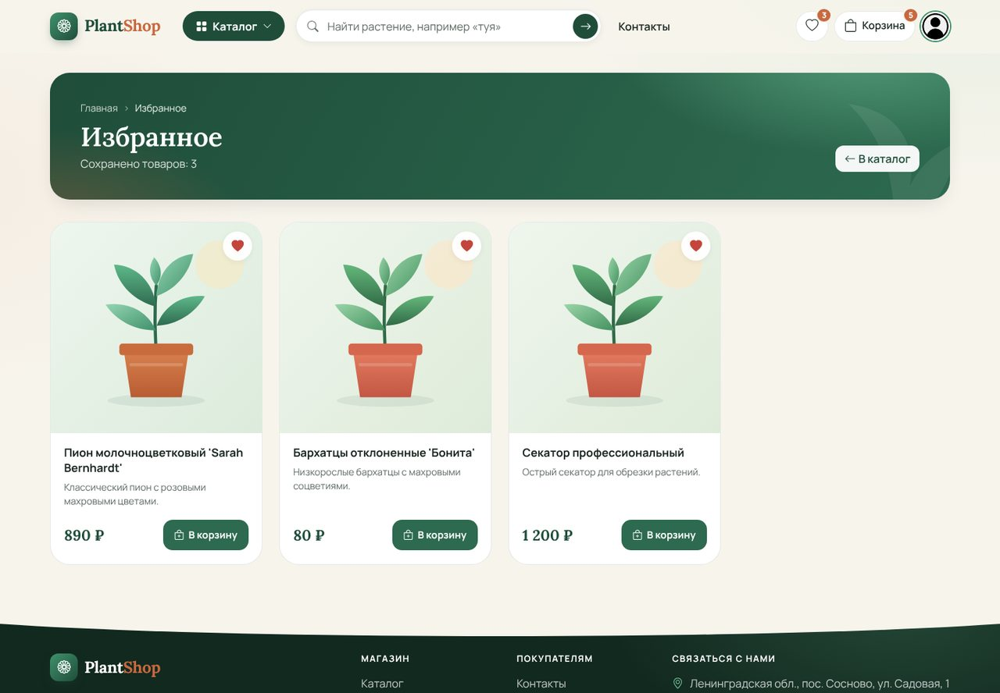
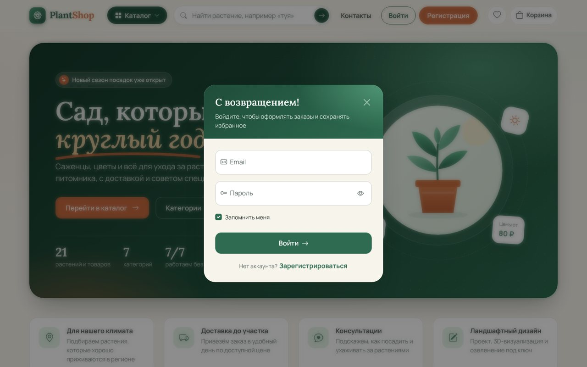
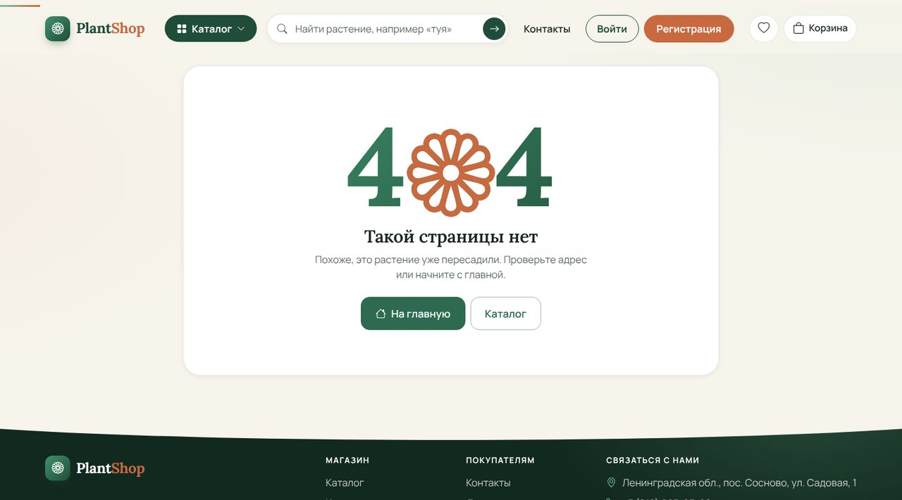

# 🌿 PlantShop — интернет-магазин растений

Полнофункциональный интернет-магазин питомника растений на **ASP.NET Core MVC**: каталог с мгновенной сортировкой и поиском, корзина и избранное без перезагрузки страницы, оформление заказа с выбором точки на карте, личный кабинет и административная панель.

**Демо:** http://91.122.60.254:8080/


---

## Содержание
- [Возможности](#возможности)
- [Скриншоты](#скриншоты)
- [Дизайн и анимации](#дизайн-и-анимации)
- [Безопасность](#безопасность)
- [Технологии](#технологии)
- [Структура проекта](#структура-проекта)
- [Установка и запуск](#установка-и-запуск)
- [Тестовые данные](#тестовые-данные)
- [Контакты](#контакты)

---

## Возможности

### Для покупателей
- **Каталог** — категории-«чипы», сортировка по цене и названию с плавной анимацией перестановки карточек, мгновенный фильтр по названию.
- **Поиск** по названию и описанию товаров из любой страницы.
- **Корзина** — добавление, изменение количества и удаление товаров без перезагрузки страницы; счётчик в шапке обновляется сразу.
- **Избранное** — сердечко на каждой карточке товара.
- **Оформление заказа** — форма с валидацией, выбор даты доставки и точки на Яндекс.Картах (адрес подставляется автоматически).
- **Личный кабинет** — личные данные, история заказов с таймлайном статуса, смена пароля с индикатором надёжности.
- **Вход и регистрация** — в модальных окнах или на отдельных страницах; после входа пользователь возвращается туда, откуда пришёл.
- Всплывающие уведомления, страницы 404 и «Нет доступа».

### Для администратора
- **Товары** — CRUD, загрузка изображений, автоматическое создание миниатюр 300×300.
- **Категории** — CRUD с изображениями.
- **Пользователи** — просмотр, редактирование данных, смена пароля, назначение ролей.
- **Заказы** — просмотр и смена статуса: Создан → В обработке → В пути → Доставлен → Отменён.
- Доступ разграничен по ролям: **Admin** — всё, **Manager** — товары, категории и заказы.

---

## Скриншоты

### Главная


### Каталог
| Каталог | Меню категорий |
|---|---|
|  |  |

| Сортировка и фильтр | Карточка товара |
|---|---|
|  |  |

### Покупка
| Добавление в корзину | Избранное |
|---|---|
|  |  |

| Корзина | Оформление заказа |
|---|---|
|  |  |


### Личный кабинет
| Мои заказы | Детали заказа |
|---|---|
|  |  |

| Личные данные | Вход |
|---|---|
|  |  |

### Административная панель
| Заказы | Товары |
|---|---|
|  |  |

### Мобильная версия


### Страница 404


---

## Дизайн и анимации
- Собственная дизайн-система поверх Bootstrap 5: лесной зелёный, кремовый фон и терракотовый акцент, шрифты **Lora** и **Manrope**.
- Адаптивная вёрстка — от телефона до широкого монитора.
- Анимации: появление блоков при прокрутке, «полёт» товара в корзину, пульсирующее сердечко избранного, плавная сортировка (FLIP), увеличение фото товара под курсором, рисующаяся галочка и конфетти после заказа, прогресс прокрутки.
- Учитывается системная настройка «уменьшить движение» (`prefers-reduced-motion`).
- Если у товара нет фото, вместо заглушки показывается аккуратная иллюстрация.

## Безопасность
- Административная панель закрыта атрибутом `[Authorize]` с разграничением по ролям.
- Корзина, избранное, заказы и профиль доступны только авторизованным пользователям; идентификатор пользователя берётся из авторизации, а не из запроса.
- Пользователь видит только свои заказы.
- Формы заказа, профиля и смены пароля защищены от CSRF.
- Пароли хранятся в виде хеша (ASP.NET Core Identity).

---

## Технологии

### Backend
- ASP.NET Core MVC (.NET 10)
- ASP.NET Core Web API — отдельный проект для REST API (JWT, Swagger)
- Entity Framework Core (Code First, миграции), SQL Server
- ASP.NET Core Identity — аутентификация, авторизация, роли
- SixLabors.ImageSharp — создание миниатюр
- Serilog — логирование
- Dependency Injection

### Frontend
- Bootstrap 5 + Bootstrap Icons
- JavaScript без фреймворков: AJAX-корзина и избранное, анимации, мгновенная сортировка и фильтр, форматирование телефона
- Yandex.Maps API — выбор адреса доставки на карте

### Развёртывание
- IIS (Windows Server) с .NET Hosting Bundle
- Права на запись в папку `wwwroot/uploads`

---

## Структура проекта
```
OnlineShop.sln
├── OnlineShop.Db        — модели, контексты EF Core, хранилища, миграции
├── OnlineShopWebApp     — сайт (MVC): контроллеры, представления, wwwroot
│   └── Areas/Admin      — административная панель
└── OnlineShopWebApi     — REST API
```

---

## Установка и запуск

1. Клонируйте репозиторий:
   ```bash
   git clone https://github.com/twixkox/OnlineShop.git
   cd OnlineShop
   ```

2. Укажите строку подключения к SQL Server в `OnlineShopWebApp/appsettings.json` (по умолчанию LocalDB):
   ```json
   "ConnectionStrings": {
     "OnlineShop": "Server=(localdb)\\MSSQLLocalDB;Database=OnlineShop;Trusted_Connection=True;"
   }
   ```

3. Запустите сайт — миграции применятся автоматически, а база заполнится тестовыми категориями и товарами:
   ```bash
   cd OnlineShopWebApp
   dotnet run
   ```

4. Откройте в браузере http://localhost:5078 (или https://localhost:5001 с профилем `https`).

> Требуется [.NET 10 SDK](https://dotnet.microsoft.com/download).

---

## Тестовые данные

**Администратор**
- Email: `admin@gmail.com`
- Пароль: `Admin12345!`

**Пользователь** — зарегистрируйтесь на сайте.

---

## Контакты
- Email: twixkox@gmail.com
- Telegram: [@twixkox](https://t.me/twixkox)
- GitHub: [twixkox](https://github.com/twixkox)
